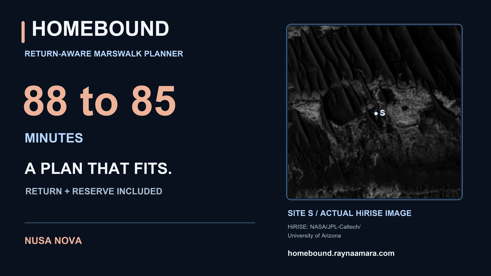

# HOMEBOUND

**Plan the science. Preserve the return.**

An explainable Marswalk planner by **Nusa Nova**, prepared for the NASA Space Apps Challenge, *Interplanetary Survival Guide: Martian Map*.

HOMEBOUND connects a science question with a complete modeled excursion: leave origin H, observe at one destination, and return to H while keeping a stated reserve. It makes the route, assumptions, time trade-off and supporting NASA sources inspectable.

**[Open the live application](https://homebound.raynaamara.com/)** |
**[Watch the 29-second demo](https://youtu.be/K8hsoKRdjxU)** |
**[Read the seven-slide deck](docs/demo/HOMEBOUND_Project_Demo_Story_EN.pdf)**



Application **1.1.12** | Decision model **1.0.0** | Public package **1.1**

## What it does

- Guides **Destination -> Activities -> Review -> Save brief**.
- Shows optical, elevation, slope, time-margin and qualitative thermal-context layers, plus a separate Gale Crater regional locator.
- Calculates outbound and return routes with directional terrain/time costs.
- Separates science interest from route availability and the time budget.
- Compares an original plan with revised observation time.
- Exports printable/PDF, TXT and traceable JSON briefs.
- Makes invalid, stale, unavailable and over-budget results explicit.

The prepared study area is approximately **1.52 km across in Gale Crater**. Site S is inside the marked study area: the regional map and detailed optical view are different datasets and scales, not identical pictures.

## A concrete decision

Under **Science walkthrough**, S has a modeled round-trip travel time of **12.40 minutes**, a **120-minute** budget and a protected **20-minute** reserve.

| Observation at S | Total required, including reserve | Extra margin | Result |
|---|---:|---:|---|
| 88 min | 120.40 min | -0.40 min | Exceeds budget |
| 85 min | 117.40 min | +2.60 min | Fits the modeled budget |

The three-minute adjustment keeps the full reserve. Display rounding is not extra physical precision.

### Explicit presets, not hidden relaxation

| Preset | Budget | Slope allowance | Use |
|---|---:|---:|---|
| Science walkthrough, initial default | 120 min | 20 degrees | Practice P and the S walkthrough |
| Terrain exploration | 180 min | 30 degrees | Explore original A/B/C routes |

Both use reserve 20 min, reference speed 30 m/min, uphill coefficient 4 and downhill coefficient 2. Selecting a destination does **not** change assumptions. Manual values that do not match a preset are labeled **Custom settings**.

At 20 degrees, A/B/C have no permitted modeled round-trip route in the prepared graph. At 30 degrees, their routes exist; the 180-minute preset also accommodates their original activities and reserve. More budget alone cannot connect terrain excluded by the slope rules. These are explicit exploration assumptions, not validated astronaut walking limits.

## NASA data and their roles

| Mission / instrument | Product or service | Role |
|---|---|---|
| MRO / HiRISE | `DTEEC_012340_1750_012195_1750_A01` | Elevation and derived slope used by routing |
| MRO / HiRISE | `ESP_012195_1750_RED_C_01_ORTHO` | Optical interpretation and S science context |
| Mars Odyssey / THEMIS | `Gale_crater_THEMIS_qualTI` | Regional qualitative context; not calibrated temperature or route cost |
| Mars Global Surveyor / MOLA, via NASA Mars Trek | `Mars_MGS_MOLA_ClrShade_merge_global_463m` | Regional orientation only; not a routing layer |

See the [data guide](data/README.md), [source catalog](data/homebound/web/sources.json), [regional provenance](data/homebound/web/regional-context.json) and [third-party notices](THIRD_PARTY_NOTICES.md) for product links, credits and licensing boundaries. Small prepared inputs and cached regional tiles are included; large original NASA downloads are not.

## Run from source

Use **Node.js 22.18 or newer** with npm. This package was checked on Windows using Node 26.13.0 and the locked dependencies.

From the repository root in Windows PowerShell:

```powershell
Set-Location .\decision-model
npm.cmd ci
npm.cmd test
npm.cmd run audit:app
npm.cmd run audit:regional
npm.cmd run audit:presets
npm.cmd run build
npm.cmd run check:delivery
npm.cmd run preview
```

Open **http://127.0.0.1:4173/**. Stop preview with Ctrl+C. On other platforms use `npm` instead of `npm.cmd`; only the Windows environment is attested by this package's verification record.

Do not double-click the HTML using `file://`: module workers and data loading require HTTP(S). Python is optional for document generation and additional browser QA; the application needs no Python backend.

### Deploy

After building, upload the **contents** of `decision-model/deploy/` to a static hosting document root or subfolder. No database, API key, npm install or Node server is needed on the hosting account. Review `.htaccess` before combining it with an existing site's configuration.

See the [deployment checklist](docs/HOMEBOUND_Application_Deployment_EN.md) and [developer methods](decision-model/README.md).

## Repository map

| Location | Contents |
|---|---|
| [decision-model/](decision-model/) | TypeScript source, tests, configuration, scripts and scoped evidence |
| [data/](data/) | Prepared NASA-derived inputs, spatial metadata and regional tile provenance |
| [docs/](docs/) | Application user guide, QA workbook and deployment instructions |
| [docs/demo/](docs/demo/) | Final MP4/SRT, music credit, PPTX/PDF deck, thumbnail and public provenance |
| [GitHub publishing guide](docs/GITHUB_PUBLISH_ID.md) | Indonesian steps for publishing this package |
| [RELEASE_MANIFEST.json](RELEASE_MANIFEST.json) | Public release file sizes, SHA-256 hashes and verification scope |

Generated `node_modules/`, `dist/` and `deploy/` are intentionally absent and ignored. They are recreated locally. The package contains no `.git` history, remote configuration or credentials. `"private": true` in the npm manifest prevents accidental npm publication; it does not prevent a public GitHub repository.

## Verification and evidence

The release is checked with the existing **160 unit/regression**, **8 application integration**, **7 regional data/model**, **8 preset data/model** and **42 static-delivery** checks. Public package 1.1 changes non-rendered regional-map metadata and its dependent image hash/cache keys; comparison with the existing deployment verifies that scientific inputs, visible map content and executable behavior remain unchanged.

The [evidence guide](decision-model/evidence/README.md) distinguishes new source-package checks from retained browser/release records. Earlier history is not silently treated as a fresh rerun. Missing optional historical archives are explicitly reported as `NOT_PRESENT`.

The final demo video is edition 1.7, with actual application **1.1.11** captures whose Science results remain unchanged in 1.1.12. It is not labeled as a new 1.1.12 capture. [Demo provenance](docs/demo/PROVENANCE.json) records the current assets and the public-copy-only deck metadata edit.

**Preserve exact bytes:** `.gitattributes` disables automatic text conversion because prepared input and release checks use byte hashes. Do not apply a repository-wide line-ending normalization to this release.

## Model scope

This is a deterministic research/planning prototype for **one destination and return**, not a live operational EVA system. Travel estimates use an explicit terrain heuristic. Oxygen, battery, fatigue, live weather/telemetry and multi-stop optimization are not modeled. A missing modeled route is not proof that no physical route exists anywhere. Scientific interpretation, travel coefficients and astronaut performance have not been independently calibrated.

## License and credits

Copyright 2026 **HOMEBOUND contributors**.

Original HOMEBOUND code and accompanying project-authored documentation are licensed under [Apache-2.0](LICENSE), subject to the [NOTICE](NOTICE). This does **not** relicense NASA products, the soundtrack or other third-party material. See [THIRD_PARTY_NOTICES.md](THIRD_PARTY_NOTICES.md).

The demo uses **"Cipher" by Kevin MacLeod**, CC BY 4.0; the [complete credit and edit statement](docs/demo/HOMEBOUND_App_Demo_Music_Credit_EN.txt) accompany the video.

Scientific imagery comes from the credited NASA products; the demonstration uses actual application captures.
